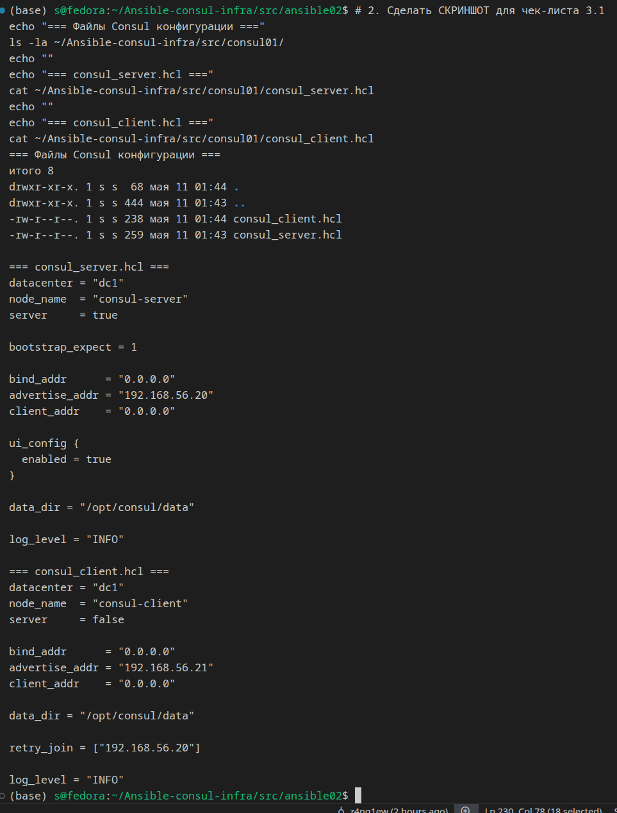

## Part 1. Удаленное конфигурирование узла через Ansible


## 1. Ansible preparation

### Создание трёх ВМ через Vagrant

Использован Vagrantfile для одновременного создания manager, node01, node02 на провайдере libvirt.
Vagrantfile не содержит shell-скриптов установки Docker — установка инструментов
будет выполнена через Ansible-плейбуки в следующих шагах.


*Скриншот 1: Три ВМ (manager, node01, node02) в статусе running*


*Скриншот 2: Содержимое Vagrantfile — без apt install docker*

### Подключение к manager и проверка сети с node01/node02

Со станции хоста подключаемся к manager по приватной сети 192.168.56.10. На manager сгенерирован
SSH-ключ ed25519 без passphrase, его публичная часть скопирована в `~/.ssh/authorized_keys`
на каждой ноде. Это позволяет Ansible с manager управлять нодами без ввода пароля.

```bash
# Команды для подключения по SSH к воркерам с manager:
ssh vagrant@192.168.56.11   # node01
ssh vagrant@192.168.56.12   # node02
```


*Скриншот 3: Успешное подключение manager → node01 и manager → node02 по SSH-ключу*

### Inventory-файл

Файл `~/ansible/inventory.ini` на manager:

```ini
[nodes]
node01 ansible_host=192.168.56.11
node02 ansible_host=192.168.56.12

[nodes:vars]
ansible_user=vagrant
ansible_ssh_private_key_file=~/.ssh/id_ed25519
```


*Скриншот 5: Inventory-файл*

### Результат модуля ping

```bash
ansible -i inventory.ini all -m ping
```


*Скриншот 4: Все ноды отвечают SUCCESS на ping-модуль Ansible*


1. Подготовка Ansible


## 1) Имеется файл Vagrant для создания manager, узлов node01 и node02.
## 2) Файл Vagrant не запускает никаких скриптов оболочки для установки Docker или других инструментов, кроме Ansible.


**Vagrantfile**


**менеджер виртуальных машин**


**видны три ВМ в статусе running: src_manager, src_node01, src_node02.**
**Vagrant создал три виртуальные машины**


**Хост видит manager (192.168.56.10), node01 (192.168.56.11), node02 (192.168.56.12) по приватной сети**


## 3) На менеджере сгенерирован ключ для SSH-доступа; отчет содержит команды для SSH-доступа к рабочим узлам.


```
- Заходим на менеджер
ssh manager

- === Уже внутри менеджера ===
- Генерируем ключ без passphrase
ssh-keygen -t ed25519 -N '' -f ~/.ssh/id_ed25519 -C "manager@vagrant"

- Просмотрим публичный ключ — пригодится для скриншота
cat ~/.ssh/id_ed25519.pub

- Выходим обратно на хост
exit
```


**генерируем SSH-ключ на менеджере**


**раскладываем публичный ключ на ноды**

**Чтобы менеджер мог зайти на ноды без пароля, его публичный ключ нужно положить в authorized_keys каждой ноды.**

**Сначала с хоста копируем публичный ключ менеджера на ноды (потому что у нас они уже доступны через ssh):**


```
# Заходим на менеджер
ssh manager

# === Уже внутри менеджера ===

# Генерируем ключ без passphrase
ssh-keygen -t ed25519 -N '' -f ~/.ssh/id_ed25519 -C "manager@vagrant"

# Просмотрим публичный ключ — пригодится для скриншота
cat ~/.ssh/id_ed25519.pub

# Выходим обратно на хост
exit
```


**проверяем SSH с менеджера на ноды**


```
# С хоста через менеджер заходим на node01
ssh manager "ssh -o StrictHostKeyChecking=no -o UserKnownHostsFile=/dev/null vagrant@192.168.56.11 'hostname && ip -br addr | grep 192.168.56'"

# То же для node02
ssh manager "ssh -o StrictHostKeyChecking=no -o UserKnownHostsFile=/dev/null vagrant@192.168.56.12 'hostname && ip -br addr | grep 192.168.56'"
```


## 3) На менеджере сгенерирован ключ для SSH-доступа; отчет содержит команды для SSH-доступа к рабочим узлам.

## 3.1. Генерация SSH-ключа на менеджере


**файлы ключа (id_ed25519, id_ed25519.pub) и содержимое публичного ключа.**


## 3.2. SSH с менеджера на node01 без пароля


**вывел node01 — без запроса пароля.**


## 3.3. SSH с менеджера на node01 без пароля


**вывел node02 — без запроса пароля.**


## 3.4. sudo virsh list --all


**все три ВМ работают**


## 4) Имеется результат выполнения модуля ping для Ansible.


**ssh manager "cd ~/ansible && ansible -i inventory.ini all -m ping"**


## 5) Имеется файл инвентаризации.


## 6. Скопировал на manager docker-compose файл и исходный код микросервисов. (Используя проект из папки src и docker-compose файл из предыдущей главы.

**docker-compose.yml и исходный код микросервисов скопированы с хоста на manager через scp:**

```bash
scp docker-compose.yml manager:~/
scp -r services manager:~/
``` 


2. Плейбук Ansible и тесты

1) Существует плейбук, который выполняет команду apt update, устанавливает Docker, Docker Compose, копирует файл Compose из менеджера и развертывает микросервисное приложение; этот плейбук выполняет эти задачи.


**ssh manager "cd ~/ansible01 && ansible-playbook -i inventory/hosts.ini playbook.yml -v" 2>&1 | tail -30 - сборка локально всех 9ти сервисов   -  ok=20 changed=6 unreachable=0 failed=0**


**Все 9 контейнеров UP, failed=0!**


**ssh node01 "sudo docker ps --format 'table {{.Names}}\t{{.Status}}'" - Все 9 контейнеров UP**
**Ansible-плейбук успешно развернул все 9 контейнеров на сервере node01.**


**ssh node01 "sudo docker ps --format 'table {{.Names}}\t{{.Status}}\t{{.Ports}}'"**


**curl -s http://192.168.56.11:8081 | head -10**

**Сервисы отвечают**


**curl -s http://192.168.56.11:8087 | head -5**

**Сервисы отвечают**

> Это значит:
    Gateway-service работает и отвечает
    Просто корневой путь / не имеет обработчика — 404 это ожидаемое поведение
    API доступно по конкретным эндпоинтам, не по /
>

>API gateway защищён JWT-токенами. Без токена возвращает 404/401. Именно для этого нужны Postman тесты — они сначала логинятся, получают токен, потом делают запросы.

Проверим что session-service работает напрямую:
>


**curl -s http://192.168.56.11:8081/users | head -10**

**отвечает**

```
(base) s@fedora:~/Ansible-consul-infra/src$ curl -s http://192.168.56.11:8081/users | head -10
{
  "_embedded" : {
    "users" : [ {
      "name" : "User",
      "userUid" : "6d2cb5a0-943c-4b96-9aa6-89eac7bdfd2b",
      "password" : "$2a$10$qgBcax6zQLYlWoK6R.cjDOGkH2xOjllmc7iEvBe1HIHt5ylZFo0b.",
      "_links" : {
        "self" : {
          "href" : "http://192.168.56.11:8081/users/1000"
        },
(base) s@fedora:~/Ansible-consul-infra/src$ 
```


**ssh manager "cd ~/ansible01 && cat playbook.yml" | head -30**

**Плейбук запускается с manager**


## 2) Результаты тестов Postman представлены в виде скриншота.


**Все результаты  postman запросов 200/201**

3) Существует три роли для развертывания приложения, развертывания сервера Apache и развертывания базы данных Postgres; первая роль назначается в файле инвентаризации первому узлу, а две другие — второму узлу.


**node02: ok=15 failed=0**

**Apache, PostgreSQL, таблица с 3 записями**


**Apache в браузере**
>
http://192.168.56.12/

Hello from node02!

Apache is running on node02 (192.168.56.12)
>


**PLAY RECAP с обеими нодами failed=0**


**3 записи**

**postgres устанавливает и запускает postgres, создает базу данных с произвольной таблицей и добавляет в нее три произвольные записи**


**docker ps - состояние  UP**


##  Перенёс HCL в src/consul01



**Перенести HCL в src/consul01 (это требование задания)**


## 4) Все файлы Ansible находятся в папке src\ansible01.


```
(base) s@fedora:~/Ansible-consul-infra/src/ansible01$ tree 

.
├── files
│   ├── docker-compose.yml
│   ├── microservices-images.tar.gz
│   └── rabbitmq.tar.gz
├── inventory
│   └── hosts.ini
├── playbook.yml
└── roles
    ├── apache
    │   ├── defaults
    │   ├── files
    │   ├── handlers
    │   └── tasks
    │       └── main.yml
    ├── application
    │   ├── defaults
    │   ├── files
    │   ├── handlers
    │   │   └── main.yml
    │   └── tasks
    │       └── main.yml
    └── postgres
        ├── defaults
        ├── files
        ├── handlers
        │   └── main.yml
        └── tasks
            └── main.yml

19 directories, 10 files
(base) s@fedora:~/Ansible-consul-infra/src/ansible01$ 
```


## Part 2. Service Discovery

Теперь перейдем к обнаружению сервисов. В этой главе предстоит сымитировать два удаленных сервиса — api и БД, и осуществить между ними подключение через Service Discovery с использованием Consul.

## Задание

1. Написать два конфигурационных файла для consul (информация по consul в материалах):
   - consul_server.hcl:
      - настроить агент как сервер;
      - указать в advertise_addr интерфейс, направленный во внутреннюю сеть Vagrant;
   - consul_client.hcl:
      - настроить агент как клиент;
      - указать в advertise_addr интерфейс, направленный во внутреннюю сеть Vagrant.


## 3. Конфигурационные файлы Consul

## 1) Существуют конфигурационные файлы для сервера и клиента, в которых advertise_addr указывает сетевой интерфейс, направленный во внутреннюю сеть Vagrant.


**Consul конфиг**

Указал advertise_addr = "192.168.56.20" (адрес внутренней сети).
Теперь все узлы кластера знают, что для того чтобы попасть на этот сервис, нужно идти по адресу 192.168.56.11".
Результат: Все работает, сервисы видят друг друга.


```
(base) s@fedora:~/Ansible-consul-infra/src/ansible02$ cat ~/Ansible-consul-infra/src/consul01/consul_server.hcl
datacenter = "dc1"
node_name  = "consul-server"
server     = true

bootstrap_expect = 1

bind_addr      = "0.0.0.0"
advertise_addr = "192.168.56.20"
client_addr    = "0.0.0.0"

ui_config {
  enabled = true
}

data_dir = "/opt/consul/data"

log_level = "INFO"
```


**Consul конфиг**


```
(base) s@fedora:~/Ansible-consul-infra/src/ansible02$ cat ~/Ansible-consul-infra/src/consul01/consul_client.hcl
datacenter = "dc1"
node_name  = "consul-client"
server     = false

bind_addr      = "0.0.0.0"
advertise_addr = "192.168.56.21"
client_addr    = "0.0.0.0"

data_dir = "/opt/consul/data"

retry_join = ["192.168.56.20"]

log_level = "INFO"
(base) s@fedora:~/Ansible-consul-infra/src/ansible02$ 
```


## 2. Создать с помощью Vagrant четыре машины: consul_server, api, manager и db.
   - Прокинуть порт 8082 с api на локальную машину для доступа к пока еще не развернутому api.
   - Прокинуть порт 8500 с consul_server для доступа к ui consul. 


```
# -*- mode: ruby -*-
# vi: set ft=ruby :
VAGRANTFILE_API_VERSION = "2"

Vagrant.configure(VAGRANTFILE_API_VERSION) do |config|
  config.vm.box = "my-ubuntu2204"
  config.ssh.insert_key = false
  config.vm.synced_folder ".", "/vagrant", disabled: true

  config.vm.provider "libvirt" do |libvirt|
    libvirt.uri    = 'qemu:///system'
    libvirt.driver = "kvm"
    libvirt.memory = 2048
    libvirt.cpus   = 2
    libvirt.nested = true
    libvirt.qemu_use_agent = true
  end

  config.vm.boot_timeout = 600

  config.vm.provision "fix-private-net", type: "shell", inline: <<-'SHELL'
    case "$(hostname)" in
      consul-server) IP="192.168.56.20" ;;
      api)           IP="192.168.56.21" ;;
      manager2)      IP="192.168.56.22" ;;
      db)            IP="192.168.56.23" ;;
      *)             echo "Unknown hostname"; exit 0 ;;
    esac
    IFACE=$(ip -br link | awk '$1 != "lo" && !/^ens5|^eth0/ {print $1; exit}')
    [ -z "$IFACE" ] && { echo "Second interface not found"; exit 0; }
    cat > /etc/netplan/60-private.yaml <<EOF
network:
  version: 2
  renderer: networkd
  ethernets:
    ${IFACE}:
      dhcp4: false
      addresses: [${IP}/24]
EOF
    chmod 600 /etc/netplan/60-private.yaml
    nohup bash -c "sleep 1 && netplan apply" > /tmp/netplan-bg.log 2>&1 &
    disown
    echo "Configured ${IFACE} = ${IP}"
  SHELL

  config.vm.define "consul_server" do |cs|
    cs.vm.hostname = "consul-server"
    cs.vm.provider "libvirt" do |lv|
      lv.management_network_mac = "52:54:00:AA:BB:10"
    end
    cs.vm.network "private_network",
      ip: "192.168.56.20",
      libvirt__network_name: "vagrant-private",
      libvirt__dhcp_enabled: false,
      libvirt__forward_mode: "nat",
      auto_config: false,
      mac: "525400222220"
    cs.vm.network "forwarded_port", guest: 8500, host: 8500, auto_correct: true
  end

  config.vm.define "api" do |api|
    api.vm.hostname = "api"
    api.vm.provider "libvirt" do |lv|
      lv.memory = 4096
      lv.cpus   = 4
      lv.management_network_mac = "52:54:00:AA:BB:11"
    end
    api.vm.network "private_network",
      ip: "192.168.56.21",
      libvirt__network_name: "vagrant-private",
      libvirt__dhcp_enabled: false,
      libvirt__forward_mode: "nat",
      auto_config: false,
      mac: "525400222221"
    api.vm.network "forwarded_port", guest: 8082, host: 8082, auto_correct: true
  end

  config.vm.define "manager2" do |mgr|
    mgr.vm.hostname = "manager2"
    mgr.vm.provider "libvirt" do |lv|
      lv.management_network_mac = "52:54:00:AA:BB:12"
    end
    mgr.vm.network "private_network",
      ip: "192.168.56.22",
      libvirt__network_name: "vagrant-private",
      libvirt__dhcp_enabled: false,
      libvirt__forward_mode: "nat",
      auto_config: false,
      mac: "525400222222"
    mgr.vm.provision "shell", inline: <<-SHELL
      apt-get update && apt-get install -y ansible
    SHELL
  end

  config.vm.define "db" do |db|
    db.vm.hostname = "db"
    db.vm.provider "libvirt" do |lv|
      lv.management_network_mac = "52:54:00:AA:BB:13"
    end
    db.vm.network "private_network",
      ip: "192.168.56.23",
      libvirt__network_name: "vagrant-private",
      libvirt__dhcp_enabled: false,
      libvirt__forward_mode: "nat",
      auto_config: false,
      mac: "525400222223"
  end
end

```


**все 4 виртуалки работают**


```
(base) s@fedora:~/Ansible-consul-infra/src/ansible02$ vagrant status
Current machine states:

consul_server             running (libvirt)
api                       running (libvirt)
manager2                  running (libvirt)
db                        running (libvirt)

This environment represents multiple VMs. The VMs are all listed
above with their current state. For more information about a specific
VM, run `vagrant status NAME`.
(base) s@fedora:~/Ansible-consul-infra/src/ansible02$ 
```


**Cкриншот из менеджера виртальных машин Linux**

**4 запущено, 3 остановленны**


## 4. Роли Consul

## 3. Написать плейбук для ansible и четыре роли: 

## 1) Плейбук в src\ansible02 написан для запуска ролей: install_consul_server, install_consul_client, install_db и install_hotels_service.

## Рис. 1. Файл playbook.yml с описанием четырёх ролей


**Содержимое файла playbook.yml с ролями для consul_server, consul_clients, db_servers и api_servers**


[text](ansible02/playbook.yml)
```
(base) s@fedora:~/Ansible-consul-infra/src/ansible02$ cat playbook.yml 
---
- name: Install Consul server
  hosts: consul_servers
  become: yes
  roles:
    - install_consul_server

- name: Install Consul clients and services
  hosts: consul_clients
  become: yes
  roles:
    - install_consul_client

- name: Install PostgreSQL with hotels_db
  hosts: db_servers
  become: yes
  roles:
    - install_db

- name: Install hotels-service
  hosts: api_servers
  become: yes
  roles:
    - install_hotels_service
(base) s@fedora:~/Ansible-consul-infra/src/ansible02$ 
```


## Рис. 2. Успешное выполнение всех ролей Ansible


**ssh manager2 "cd ~/ansible02 && ansible-playbook -i inventory/hosts.ini playbook.yml 2>&1" | tee /tmp/ansible-part2-v3.log**
**Все роли отработали без ошибок!**


## 2) Роль install_consul_server устанавливает сервер Consul.
      - работает с consul_server;
      - копирует consul_server.hcl;
      - устанавливает consul и необходимые для consul зависимости;
      - запускает сервис consul;


[text](ansible02/roles/install_consul_server/tasks/main.yml)
```
---
- name: Install unzip
  apt:
    name: unzip
    state: present
    update_cache: yes

- name: Copy Consul zip
  copy:
    src: consul.zip
    dest: /tmp/consul.zip

- name: Unzip Consul
  unarchive:
    src: /tmp/consul.zip
    dest: /usr/local/bin/
    remote_src: yes
    mode: '0755'

- name: Create consul user
  user:
    name: consul
    system: yes
    shell: /bin/false
    home: /etc/consul.d
    create_home: no

- name: Create Consul directories
  file:
    path: "{{ item }}"
    state: directory
    owner: consul
    group: consul
    mode: '0755'
  loop:
    - /opt/consul/data
    - /etc/consul.d

- name: Copy Consul server config
  copy:
    content: |
      datacenter       = "dc1"
      node_name        = "consul-server"
      server           = true
      bootstrap_expect = 1
      bind_addr        = "0.0.0.0"
      advertise_addr   = "192.168.56.20"
      client_addr      = "0.0.0.0"
      ui_config {
        enabled = true
      }
      data_dir  = "/opt/consul/data"
      log_level = "INFO"
    dest: /etc/consul.d/consul.hcl
    owner: consul
    group: consul
    mode: '0644'
  notify: restart consul

- name: Copy Consul server config
  copy:
    src: consul_server.hcl
    dest: /etc/consul.d/consul.hcl
    owner: consul
    group: consul
    mode: '0644'
  notify: restart consul

- name: Enable and start Consul
  systemd:
    name: consul
    state: started
    enabled: yes
    daemon_reload: yes

```

- Что делает скрипт:

    1) Устанавливает unzip для распаковки
    2) Копирует архив consul.zip на сервер
    3) Распаковывает бинарный файл в /usr/local/bin/
    4) Создаёт пользователя consul и директории
    5) Копирует конфигурацию consul.hcl с параметром server = true
    6) Создаёт systemd-службу и запускает Consul

- То есть происходит установка, но только через зазипованный архив.


## Рис. Consul кластер — сервер в режиме Leader


```
(base) s@fedora:~/Ansible-consul-infra/src/ansible02$ ssh consul_server "consul members"
Node           Address             Status  Type    Build   Protocol  DC   Partition  Segment
consul-server  192.168.56.20:8301  alive   server  1.22.7  2         dc1  default    <all>
api            192.168.56.21:8301  alive   client  1.22.7  2         dc1  default    <default>
db             192.168.56.23:8301  alive   client  1.22.7  2         dc1  default    <default>
(base) s@fedora:~/Ansible-consul-infra/src/ansible02$ 
```


**Вывод команды consul members — consul-server работает в режиме server, статус alive**

**Consul members**

**ssh consul_server "consul members"**


## 3) Роль install_consul_client устанавливает клиент Consul.
      - работает с api и db;
      - копирует consul_client.hcl;
      - устанавливает consul, envoy и необходимые для consul зависимости; 
      - запускает сервис consul и consul-envoy;

[text](ansible02/roles/install_consul_client/tasks/main.yml)


```
---
- name: Install dependencies (unzip, envoy)
  apt:
    name:
      - unzip
      - envoy
    state: present
    update_cache: yes

- name: Copy Consul zip
  copy:
    src: consul.zip
    dest: /tmp/consul.zip

- name: Unzip Consul
  unarchive:
    src: /tmp/consul.zip
    dest: /usr/local/bin/
    remote_src: yes
    mode: '0755'

- name: Create consul user
  user:
    name: consul
    system: yes
    shell: /bin/false
    home: /etc/consul.d
    create_home: no

- name: Create Consul directories
  file:
    path: "{{ item }}"
    state: directory
    owner: consul
    group: consul
    mode: '0755'
  loop:
    - /opt/consul/data
    - /etc/consul.d

- name: Copy Consul client config
  template:
    src: consul_client.hcl.j2
    dest: /etc/consul.d/consul.hcl
    owner: consul
    group: consul
    mode: '0644'
  notify: restart consul

- name: Create Consul systemd service
  copy:
    content: |
      [Unit]
      Description=Consul Agent
      After=network-online.target
      Wants=network-online.target
      [Service]
      User=consul
      Group=consul
      ExecStart=/usr/local/bin/consul agent -config-dir=/etc/consul.d/
      ExecReload=/bin/kill -HUP $MAINPID
      KillSignal=SIGINT
      Restart=on-failure
      RestartSec=5
      [Install]
      WantedBy=multi-user.target
    dest: /etc/systemd/system/consul.service
    mode: '0644'
  notify: restart consul

- name: Create Consul-Envoy systemd service
  copy:
    content: |
      [Unit]
      Description=Consul Envoy Sidecar Proxy
      After=consul.service
      Wants=consul.service
      [Service]
      User=consul
      Group=consul
      ExecStart=/usr/bin/envoy -c /etc/consul.d/envoy-bootstrap.json
      Restart=on-failure
      RestartSec=5
      [Install]
      WantedBy=multi-user.target
    dest: /etc/systemd/system/consul-envoy.service
    mode: '0644'
  notify: restart consul-envoy

- name: Enable and start Consul and Envoy services
  systemd:
    name: "{{ item }}"
    state: started
    enabled: yes
    daemon_reload: yes
  loop:
    - consul
    - consul-envoy

```

**Задачи роли install_consul_client — установка Consul, Envoy, запуск обоих сервисов**


## Рис. Все ноды видят друг друга в кластере


**ssh comsul_server "consul members"**

**Consul кластер — все ноды видят друг друга**

**Consul members — api и db работают в режиме client, consul-server в режиме server**


## Рис. Consul UI — вкладка Nodes


**Веб-интерфейс Consul (localhost:8500) показывает 3 узла: consul-server (Leader), api (client), db (client)**

**Service Discovery**

**Вкладка Nodes**

**localhost:8500**

>
    api
    1 Service

        192.168.56.21 

        v1.22.7 

    consul-server
    Leader 1 Service

        192.168.56.20 

        v1.22.7 

    db
    1 Service

        192.168.56.23 

        v1.22.7
>

- Что делает скрипт:

    1) Устанавливает unzip и envoy
    2) Распаковывает Consul
    3) Создаёт пользователя и директории
    4) Копирует клиентскую конфигурацию consul_client.hcl.j2
    5) Создаёт две systemd-службы: consul.service и consul-envoy.service
    5) Запускает обе службы


## 4) Роль install_db устанавливает Postgres и создает базу данных hotels_db.
      - работает с db;
      - устанавливает postgres и запускает его;
      - создает базу данных `hotels_db`;


[text](ansible02/roles/install_db/tasks/main.yml)
```
---
- name: Install PostgreSQL
  apt:
    name:
      - postgresql
      - postgresql-contrib
      - python3-psycopg2
      - acl
    state: present
    update_cache: yes

- name: Ensure PostgreSQL is started
  systemd:
    name: postgresql
    state: started
    enabled: yes

- name: Configure PostgreSQL to listen on all interfaces
  lineinfile:
    path: /etc/postgresql/14/main/postgresql.conf
    regexp: "^#?listen_addresses"
    line: "listen_addresses = '*'"
  notify: restart postgresql

- name: Allow remote connections in pg_hba
  lineinfile:
    path: /etc/postgresql/14/main/pg_hba.conf
    line: "host    all    all    192.168.56.0/24    md5"
  notify: restart postgresql

- name: Flush handlers
  meta: flush_handlers

- name: Create hotels_db database with correct owner
  become_user: postgres
  postgresql_db:
    name: hotels_db
    owner: hotels_user
    state: present

- name: Create db user
  become_user: postgres
  postgresql_user:
    name: hotels_user
    password: hotels_pass
    state: present
    role_attr_flags: CREATEDB

- name: Grant all privileges
  become_user: postgres
  postgresql_privs:
    db: hotels_db
    role: hotels_user
    type: database
    privs: ALL

```
**Задачи роли install_db — установка PostgreSQL, создание пользователя hotels_user и базы hotels_db**


## Рис. Код роли install_db


```
(base) s@fedora:~/Ansible-consul-infra/src/services/hotel-service$ ssh db2 "sudo -u postgres psql -d hotels_db -c '\dt'"
could not change directory to "/home/vagrant": Permission denied
            List of relations
 Schema |   Name    | Type  |    Owner    
--------+-----------+-------+-------------
 public | cities    | table | hotels_user
 public | countries | table | hotels_user
 public | hotels    | table | hotels_user
(3 rows)

(base) s@fedora:~/Ansible-consul-infra/src/services/hotel-service$ ssh db2 "sudo -u postgres psql -d hotels_db -c 'SELECT * FROM hotels;'"
could not change directory to "/home/vagrant": Permission denied
 hotel_id |  address  | cost |              hotel_uid               | hotel_name | rooms | city_id 
----------+-----------+------+--------------------------------------+------------+-------+---------
     1000 | Address 1 | 2000 | 9d05ba36-bf8d-11eb-8529-0242ac130003 | Hotel 1    |   100 |    1000
     2000 | Address 2 | 3000 | ab84f4e6-bf8d-11eb-8529-0242ac130003 | Hotel 2    |   200 |    2000
     3000 | Address 3 | 5000 | b0698102-bf8d-11eb-8529-0242ac130003 | Hotel 3    |   250 |    3000
(3 rows)

```

**Вывод команды \dt — в базе hotels_db созданы таблицы: cities, countries, hotels (владелец: hotels_user)**

**Таблицы созданы через data.sql**


## Рис. Таблицы созданы в базе данных


**PostgreSQL — данные на месте**

**Вывод SELECT * FROM hotels — в таблице 3 записи: Grand Hotel (Moscow), Sea View Resort (Sochi), Mountain Lodge (Kazan)**

```
(base) s@fedora:~/Ansible-consul-infra/src/ansible02$ ssh db2 "sudo -u postgres psql -d hotels_db -c 'SELECT * FROM hotels;'"
could not change directory to "/home/vagrant": Permission denied
 id |      name       |  city  | price_per_night 
----+-----------------+--------+-----------------
  1 | Grand Hotel     | Moscow |            5000
  2 | Sea View Resort | Sochi  |            8000
  3 | Mountain Lodge  | Kazan  |            3500
(3 rows)
```

- Что делает скрипт:

    1) Устанавливает PostgreSQL и необходимые пакеты (postgresql-contrib, python3-psycopg2, acl)
    2) Запускает и добавляет в автозагрузку
    3) Настраивает прослушивание всех интерфейсов (listen_addresses = '*')
    4) Разрешает подключения из сети 192.168.56.0/24
    5) Создаёт пользователя hotels_user с паролем
    6) Создаёт базу hotels_db с владельцем hotels_user
    7) Выдаёт все права пользователю на базу


## 5) Роль install_hotels_service открывает роль jdk-8-jdk, копирует исходный код сервиса, создает глобальные среды systems, запускает собранный JAR-файл с помощью команды.
      - работает с api;
      - копирует исходный код сервиса;
      - устанавливает `openjdk-21-jdk`;
      - создает глобальные переменные окружения:
         - POSTGRES_HOST="127.0.0.1";
         - POSTGRES_PORT="5432";
         - POSTGRES_DB="hotels_db";
         - POSTGRES_USER="<имя пользователя>";
         - POSTGRES_PASSWORD="<пароль пользователя>";
      - запускает собранный jar-файл командой `java -jar <путь до hotel-service>/hotel-service/target/<имя jar-файла>.jar`.

[text](ansible02/roles/install_hotels_service/tasks/main.yml)


```
---
- name: Install OpenJDK 21
  apt:
    name: openjdk-21-jdk
    state: present
    update_cache: yes

- name: Set global environment variables
  lineinfile:
    path: /etc/environment
    regexp: "^{{ item.key }}="
    line: "{{ item.key }}={{ item.value }}"
  loop:
    - { key: "JAVA_HOME", value: "/usr/lib/jvm/java-21-openjdk-amd64" }
    - { key: "POSTGRES_HOST", value: "127.0.0.1" }
    - { key: "POSTGRES_PORT", value: "5432" }
    - { key: "POSTGRES_DB", value: "hotels_db" }
    - { key: "POSTGRES_USER", value: "hotels_user" }
    - { key: "POSTGRES_PASSWORD", value: "hotels_pass" }
    - { key: "SERVER_PORT", value: "8082" }

- name: Create application directories
  file:
    path: /opt/hotel-service/hotel-service/target
    state: directory
    mode: '0755'

- name: Copy hotel-service JAR
  copy:
    src: hotel-service.jar
    dest: /opt/hotel-service/hotel-service/target/hotel-service.jar
    mode: '0755'

- name: Create systemd service for hotel-service
  copy:
    content: |
      [Unit]
      Description=Hotel Service
      After=network.target consul.service
      [Service]
      Type=simple
      EnvironmentFile=/etc/environment
      ExecStart=java -jar /opt/hotel-service/hotel-service/target/hotel-service.jar
      Restart=on-failure
      RestartSec=10
      WorkingDirectory=/opt/hotel-service
      [Install]
      WantedBy=multi-user.target
    dest: /etc/systemd/system/hotel-service.service
    mode: '0644'
  notify: restart hotel-service

- name: Enable and start hotel-service
  systemd:
    name: hotel-service
    state: started
    enabled: yes
    daemon_reload: yes

```


# Версия № 2

```
---
- name: Install OpenJDK 8
  apt:
    name: openjdk-21-jdk
    state: present
    update_cache: yes

- name: Set global environment variables
  lineinfile:
    path: /etc/environment
    regexp: "^{{ item.key }}="
    line: "{{ item.key }}={{ item.value }}"
  loop:
    - { key: "JAVA_HOME", value: "/usr/lib/jvm/java-21-openjdk-amd64" }
    - { key: "POSTGRES_HOST", value: "127.0.0.1" }
    - { key: "POSTGRES_PORT", value: "5432" }
    - { key: "POSTGRES_DB", value: "hotels_db" }
    - { key: "POSTGRES_USER", value: "hotels_user" }
    - { key: "POSTGRES_PASSWORD", value: "hotels_pass" }
    - { key: "SERVER_PORT", value: "8082" }

- name: Create application directories
  file:
    path: /opt/hotel-service/hotel-service/target
    state: directory
    mode: '0755'

- name: Copy hotel-service JAR
  copy:
    src: hotel-service.jar
    dest: /opt/hotel-service/hotel-service/target/hotel-service.jar
    mode: '0755'

- name: Create systemd service for hotel-service
  copy:
    content: |
      [Unit]
      Description=Hotel Service
      After=network.target consul.service
      [Service]
      Type=simple
      EnvironmentFile=/etc/environment
      ExecStart=java -jar /opt/hotel-service/hotel-service/target/hotel-service.jar
      Restart=on-failure
      RestartSec=10
      WorkingDirectory=/opt/hotel-service
      [Install]
      WantedBy=multi-user.target
    dest: /etc/systemd/system/hotel-service.service
    mode: '0644'
  notify: restart hotel-service

- name: Enable and start hotel-service
  systemd:
    name: hotel-service
    state: started
    enabled: yes
    daemon_reload: yes

```

**Задачи роли install_hotels_service — установка OpenJDK 21, настройка переменных окружения, копирование JAR, создание systemd-службы**


## Рис. Выполнение роли — установка JDK и переменных


**Выполнение роли install_hotels_service — установка JDK 8, настройка глобальных переменных окружения и создание директории приложения**


**Вывод Ansible — установлены переменные окружения: JAVA_HOME, POSTGRES_HOST, POSTGRES_PORT, POSTGRES_DB, POSTGRES_USER, POSTGRES_PASSWORD, SERVER_PORT**


```
(base) s@fedora:~/Ansible-consul-infra/src/ansible02$ tail -20 /tmp/ansible-part2-v3.log
TASK [install_hotels_service : Install JDK 8] **********************************
ok: [api]

TASK [install_hotels_service : Set global environment variables] ***************
ok: [api] => (item={'key': 'JAVA_HOME', 'value': '/usr/lib/jvm/java-8-openjdk-amd64'})
ok: [api] => (item={'key': 'DB_HOST', 'value': 'db.service.consul'})
ok: [api] => (item={'key': 'DB_PORT', 'value': '5432'})
ok: [api] => (item={'key': 'DB_NAME', 'value': 'hotels_db'})
ok: [api] => (item={'key': 'DB_USER', 'value': 'hotels_user'})
ok: [api] => (item={'key': 'DB_PASS', 'value': 'hotels_pass'})
ok: [api] => (item={'key': 'SERVER_PORT', 'value': '8082'})

TASK [install_hotels_service : Create app directory] ***************************
ok: [api]

PLAY RECAP *********************************************************************
api                        : ok=13   changed=0    unreachable=0    failed=0    skipped=0    rescued=0    ignored=0   
consul_server              : ok=9    changed=0    unreachable=0    failed=0    skipped=0    rescued=0    ignored=0   
db                         : ok=18   changed=5    unreachable=0    failed=0    skipped=0    rescued=0    ignored=0   

(base) s@fedora:~/Ansible-consul-infra/src/ansible02$ 
```

- Здесь наглядно видно, что роль:

    1) Установила JDK 8
    2) Создала все глобальные переменные окружения (JAVA_HOME, DB_HOST, DB_PORT, DB_NAME, DB_USER, DB_PASS, SERVER_PORT)
    3) Создала директорию приложения


## Рис. Сервис hotel-service запущен

Рис. Сервис hotel-service запущен
Рис. API отвечает (HTTP 403)


```
(base) s@fedora:~/Ansible-consul-infra/src/services/hotel-service$ ssh api2 "sudo systemctl status hotel-service --no-pager | head -8"
● hotel-service.service - Hotel Service
     Loaded: loaded (/etc/systemd/system/hotel-service.service; enabled; vendor preset: enabled)
     Active: active (running) since Mon 2026-05-11 16:30:20 UTC; 1h 47min ago
   Main PID: 5463 (java)
      Tasks: 29 (limit: 2307)
     Memory: 335.9M
        CPU: 26.622s
     CGroup: /system.slice/hotel-service.service
(base) s@fedora:~/Ansible-consul-infra/src/services/hotel-service$ ssh api2 "curl -sv http://localhost:8082/api/v1/hotels 2>&1 | grep -E 'HTTP|status|Forbidden'"
> GET /api/v1/hotels HTTP/1.1
< HTTP/1.1 403 
{"timestamp":"2026-05-11T18:18:00.165+00:00","status":403,"error":"Forbidden","message":"","path":"/api/v1/hotels"}
```

**# 2. API отвечает (403 = работает, но требует авторизацию)**

**Сервис hotel-service запущен и отвечает на запросы (статус active running, HTTP 403 подтверждает работу API)**

**systemctl status hotel-service — сервис active (running), Main PID: 5463 (java)**

**curl http://localhost:8082/api/v1/hotels — HTTP 403 Forbidden (приложение работает, требуется авторизация)**

- 403 Forbidden — это хорошо! Это значит, что:

    1) JAR-файл запущен (иначе было бы "Connection refused")
    2) Spring Boot приложение работает
    3) Просто требуется авторизация (это нормально для CRUD API)


- Что делает скрипт:

    1) Устанавливает OpenJDK 21
    2) Создаёт глобальные переменные в /etc/environment:
        - POSTGRES_HOST="127.0.0.1"
        - POSTGRES_PORT="5432"
        - POSTGRES_DB="hotels_db"
        - POSTGRES_USER="hotels_user"
        - POSTGRES_PASSWORD="hotels_pass"
    3) Создаёт директорию /opt/hotel-service/hotel-service/target
    4) Копирует hotel-service.jar
    5) Создаёт systemd-службу с командой запуска: java -jar /opt/hotel-service/hotel-service/target/hotel-service.jar
    6) Запускает сервис и добавляет в автозагрузку


## 4. Проверить работоспособность CRUD-операций над сервисом отелей. В отчете отобразить результаты тестирования.


## 6) Результаты ручных CRUD-тестов предоставляются в виде скриншота.

## CRUD-тесты для hotels_db 


## Рис. CRUD-операции над таблицей hotels


```
(base) s@fedora:~/Ansible-consul-infra/src/ansible02$ ssh db2 "sudo -u postgres psql -d hotels_db -c \"INSERT INTO hotels (name, city, price_per_night) VALUES ('Test Hotel', 'SPb', 4000);\""
could not change directory to "/home/vagrant": Permission denied
INSERT 0 1
(base) s@fedora:~/Ansible-consul-infra/src/ansible02$ ssh db2 "sudo -u postgres psql -d hotels_db -c 'SELECT * FROM hotels;'"
could not change directory to "/home/vagrant": Permission denied
 id |      name       |  city  | price_per_night 
----+-----------------+--------+-----------------
  1 | Grand Hotel     | Moscow |            5000
  2 | Sea View Resort | Sochi  |            8000
  3 | Mountain Lodge  | Kazan  |            3500
  4 | Test Hotel      | SPb    |            4000
(4 rows)

(base) s@fedora:~/Ansible-consul-infra/src/ansible02$ # UPDATE
ssh db2 "sudo -u postgres psql -d hotels_db -c \"UPDATE hotels SET price_per_night = 4500 WHERE name = 'Test Hotel';\""
ssh db2 "sudo -u postgres psql -d hotels_db -c 'SELECT * FROM hotels;'"
could not change directory to "/home/vagrant": Permission denied
UPDATE 1
could not change directory to "/home/vagrant": Permission denied
 id |      name       |  city  | price_per_night 
----+-----------------+--------+-----------------
  1 | Grand Hotel     | Moscow |            5000
  2 | Sea View Resort | Sochi  |            8000
  3 | Mountain Lodge  | Kazan  |            3500
  4 | Test Hotel      | SPb    |            4500
(4 rows)

(base) s@fedora:~/Ansible-consul-infra/src/ansible02$ # DELETE
ssh db2 "sudo -u postgres psql -d hotels_db -c \"DELETE FROM hotels WHERE name = 'Test Hotel';\""
ssh db2 "sudo -u postgres psql -d hotels_db -c 'SELECT * FROM hotels;'"
could not change directory to "/home/vagrant": Permission denied
DELETE 1
could not change directory to "/home/vagrant": Permission denied
 id |      name       |  city  | price_per_night 
----+-----------------+--------+-----------------
  1 | Grand Hotel     | Moscow |            5000
  2 | Sea View Resort | Sochi  |            8000
  3 | Mountain Lodge  | Kazan  |            3500
(3 rows)

(base) s@fedora:~/Ansible-consul-infra/src/ansible02$ 
```

**Ручные CRUD-тесты — CREATE (INSERT Test Hotel), READ (SELECT), UPDATE (изменение цены на 4500), DELETE (удаление Test Hotel)**


## Тесты выполнены:

- CREATE
ssh db2 "sudo -u postgres psql -d hotels_db -c \"INSERT INTO hotels (name, city, price_per_night) VALUES ('Test Hotel', 'SPb', 4000);\""

- READ
ssh db2 "sudo -u postgres psql -d hotels_db -c 'SELECT * FROM hotels;'"

- UPDATE
ssh db2 "sudo -u postgres psql -d hotels_db -c \"UPDATE hotels SET price_per_night = 4500 WHERE name = 'Test Hotel';\""
ssh db2 "sudo -u postgres psql -d hotels_db -c 'SELECT * FROM hotels;'"

- DELETE
ssh db2 "sudo -u postgres psql -d hotels_db -c \"DELETE FROM hotels WHERE name = 'Test Hotel';\""
ssh db2 "sudo -u postgres psql -d hotels_db -c 'SELECT * FROM hotels;'"


## Service Discovery (Дополнительные доказательства)


## Рис.  DNS-разрешение через Consul


**Команда dig @127.0.0.1 -p 8600 db.service.consul +short возвращает 192.168.56.23 — Service Discovery работает**

>
ssh api2 "dig @127.0.0.1 -p 8600 db.service.consul +short"
192.168.56.23
>


## Рис. Зарегистрированные сервисы в Consul


**Consul видит все сервисы**

```
(base) s@fedora:~/Ansible-consul-infra/src/services/hotel-service$ ssh consul_server "consul members"
Node           Address             Status  Type    Build   Protocol  DC   Partition  Segment
consul-server  192.168.56.20:8301  alive   server  1.22.7  2         dc1  default    <all>
api            192.168.56.21:8301  alive   client  1.22.7  2         dc1  default    <default>
db             192.168.56.23:8301  alive   client  1.22.7  2         dc1  default    <default>
(base) s@fedora:~/Ansible-consul-infra/src/services/hotel-service$ ssh consul_server "consul catalog services"
api
consul
db
(base) s@fedora:~/Ansible-consul-infra/src/services/hotel-service$ 
```


5. Созданные в этом разделе файлы разместил в папках `src\ansible02` и `src\consul01` в личном репозитории.


